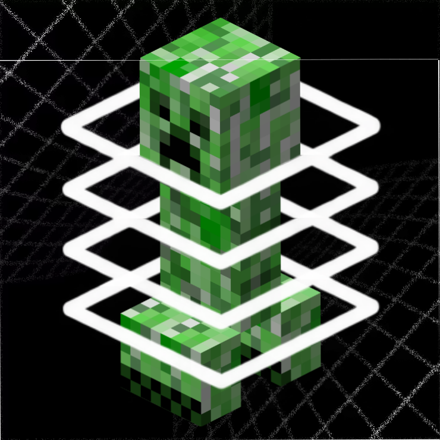

<p align="center">
  
</p>

<h1 align="center">Skein</h1>

<p align="center">
  <b>Multithreaded server ticking for Minecraft</b><br>
  Forge and NeoForge &middot; 1.20.1, 1.21.1, 1.21.11 and 26.2 &middot; server-side only &middot; all rights reserved
</p>

---

A Minecraft server does nearly all of its game work on one thread. Skein spreads that work out.
Each dimension ticks on its own thread. Inside a dimension, random ticks, entities and block
entities are cut into regions of the world that are far enough apart to tick at the same time.
A barrier closes before anything downstream can see the difference, so every tick still ends
exactly where vanilla ends it. Players joining a server running Skein don't need it installed.

- **Dimension threading.** The Overworld, the Nether and the End tick side by side, and the
  server waits for all of them before connections, players and chunk sending run, which is
  exactly where vanilla runs those. Tick events still fire on the server thread, in their usual order.
- **Region threading inside a dimension.** The level is cut into square cells, and any reach a
  tick can have (a mob's pathfinding, a hopper's neighbour, a sapling becoming a tree) stays
  inside a safety margin, so cells that run together never touch the same blocks. Four offset grids
  mean no position sits on an edge. Mobs that reach further than the margin, like villagers, get
  their own coarser passes instead of falling back to the main thread.
- **Redstone in parallel, in vanilla's exact order.** Scheduled ticks (repeaters, comparators,
  observers, fluids, falling blocks) run in groups of what can affect each other, each in vanilla's
  order, and what the groups share is put back in vanilla's order too, down to the sub-tick numbers
  of new ticks. A fuzzer checks it tick for tick against vanilla.
- **A cluster tier for dense farms.** Thousands of items, XP orbs or snowballs piled into one spot
  are ordered by what they can actually reach, rather than by where they are.
- **It knows when not to bother.** Every phase is timed both ways, and a phase that doesn't pay
  for its barrier quietly runs the vanilla way. `/skein status` shows the verdict.
- **TNT cannons.** A piston pushing a stack of tens of thousands of primed TNT used to cost the
  square of the stack: every TNT asked about every other one. Skein answers those queries from a
  short per-section list of the entities that can actually be collided with, and spreads a big push
  over the worker threads. The TNT still ends up exactly where vanilla puts it.

## Versions

Each folder is a complete project for one Minecraft version and loader. They share the same
features, commands and config keys, so a server can change version or loader and keep its config.
New work lands in one folder first and is ported to the rest; as of 1.1.0 all eight carry the same
work. Fixes for another mod apply where that mod exists for the version: Create on 1.20.1 and
1.21.1 NeoForge, SuperChunk on 1.20.1, 1.21.1 NeoForge and 1.21.11 NeoForge, Alternate Current on
NeoForge 1.21.1, 1.21.11 and 26.2.

| Folder | Minecraft | Loader | Java |
|---|---|---|---|
| [`26.2-neoforge`](26.2-neoforge) | 26.2 | NeoForge 26.2.0+ | 25 |
| [`26.2-forge`](26.2-forge) | 26.2 | Forge 65+ | 25 |
| [`1.21.11-neoforge`](1.21.11-neoforge) | 1.21.11 | NeoForge 21.11+ | 21 |
| [`1.21.11-forge`](1.21.11-forge) | 1.21.11 | Forge 61+ | 21 |
| [`1.21.1-neoforge`](1.21.1-neoforge) | 1.21.1 | NeoForge 21.1+ | 21 |
| [`1.21.1-forge`](1.21.1-forge) | 1.21.1 | Forge 52+ | 21 |
| [`1.20.1-neoforge`](1.20.1-neoforge) | 1.20.1 | NeoForge 47.1 | 17 |
| [`1.20.1-forge`](1.20.1-forge) | 1.20.1 | Forge 47+ | 17 |

Put the jar for your version (a release build, or one you [build](#building) yourself) in the server's
`mods` folder. There are no other dependencies.
Skein also runs in singleplayer, where the integrated server gets the same treatment.

## Performance

The same generated world on each version and loader, on a dedicated server with and without Skein
(8 worker threads, nine connected players). Each cell is vanilla ms/tick &rarr; Skein ms/tick.

| | 1440 mobs in pens | farmland at `randomTickSpeed 80` | everything at once, plus a busy Nether |
|---|---|---|---|
| 26.2 NeoForge | 12.1 &rarr; 5.8 (**2.1x**) | 6.5 &rarr; 2.4 (**2.7x**) | 27.8 &rarr; 8.3 (**3.4x**) |
| 26.2 Forge | 12.4 &rarr; 6.3 (**2.0x**) | 6.7 &rarr; 2.4 (**2.8x**) | 28.0 &rarr; 8.4 (**3.4x**) |
| 1.21.11 NeoForge | 14.6 &rarr; 6.9 (**2.1x**) | 8.8 &rarr; 2.8 (**3.2x**) | 28.3 &rarr; 9.0 (**3.2x**) |
| 1.21.11 Forge | 12.4 &rarr; 5.9 (**2.1x**) | 6.2 &rarr; 2.5 (**2.5x**) | 28.0 &rarr; 8.4 (**3.3x**) |
| 1.21.1 NeoForge | 13.9 &rarr; 8.6 (**1.6x**) | 8.4 &rarr; 3.7 (**2.3x**) | 25.0 &rarr; 11.4 (**2.2x**) |
| 1.21.1 Forge | 12.1 &rarr; 7.2 (**1.7x**) | 5.7 &rarr; 2.7 (**2.1x**) | 23.2 &rarr; 10.2 (**2.3x**) |
| 1.20.1 NeoForge | 14.7 &rarr; 8.6 (**1.7x**) | 4.5 &rarr; 2.6 (**1.7x**) | 24.8 &rarr; 10.2 (**2.4x**) |
| 1.20.1 Forge | 15.4 &rarr; 8.7 (**1.8x**) | 4.5 &rarr; 2.7 (**1.7x**) | 25.1 &rarr; 10.2 (**2.5x**) |

Those are release 1.0.1. 1.1.0 is faster again, measured on 1.21.1 NeoForge:
the mob scenario **28%** and the mixed scenario **20%** below 1.0.1, and a quiet server 17% below,
from villagers no longer ticking serially, an adaptive governor that re-measures properly, and
cheaper bookkeeping ([report](1.21.1-neoforge/docs/optimization-2026-10-09.md)). On a quiet
server, Skein stays within run-to-run noise of vanilla, because phases that don't pay switch off.

**TNT cannons** (Orbital Skybender, 26.2 NeoForge, a 30,660-TNT payload): release 1.0.1 averaged
288 ms/tick with 1.5-second spikes and built only 38% of the payload in nine minutes; the current
source builds all of it at 54 ms/tick, and its biggest pushes went from 1.2 seconds to under 0.1
([report](26.2-neoforge/docs/tnt-cannons-2026-10-10.md)).

## Correctness

Skein is built around not changing what the game does, only when it happens:

- redstone run in parallel (`scheduledTicks`) matches vanilla tick for tick, with
  block entities ordered as well: a fuzzer builds 48 random circuits (pistons, observers, comparators, falling
  sand, minecarts on detector rails, pressure plates, tripwire, sculk sensors, hoppers, water) and compares
  every block, entity and pending tick, in order, with vanilla for 600 ticks, over six seeds and 2 to 16
  threads ([how](26.2-neoforge/docs/redstone-parity-2026-10-11.md))
- items moved through 121 hopper rings are counted before and after: 7,744 in, 7,744 out, in every configuration
- nine sealed water and lava basins stepped 400 ticks give byte-identical results, serial and parallel
- a TNT cannon's 5,070-TNT payload ends in exactly vanilla's positions and fuses
- worker threads never load chunks; anything near the edge of loaded terrain ticks on the main thread
- vanilla state that is unsafe to share (redstone torch burnout, wire power, raids, loot random
  sequences, points of interest, captured drops) is made thread-safe or deferred to the barrier
- a type that throws or hangs while ticking in parallel is moved back to the main thread, and remembered

Scheduled ticks (redstone, fluids, falling blocks) keep vanilla's order exactly, and what they share
-- block events, new entities, the sub-tick numbers of new ticks -- is put back in vanilla's order too.
Block entities can do the same (`blockEntities.vanillaOrderLimit`); it is off by default because a
dense contraption such as a TNT cannon is then one group on one thread. Elsewhere the *order* of work
within a single tick can change (for entities and random ticks vanilla's is insertion order and a shuffle; Skein's is
deterministic but different), and a few reactions arrive one pass later in the same tick. Random
draws and entity ids are not vanilla's either, but vanilla does not reproduce those between runs.

## Compatibility

Every Skein hook is optional. If another mod rewrites a method Skein needs, Skein switches off only
the feature that hook serves, logs which mod changed it, and the game keeps loading. Compatibility
fixes for specific mods load only when that mod is installed. Tested with:

- **Lithium**, and its 1.20.1 ports **Canary** and **Radium**. A handful of their options keep
  per-level caches that in-level threading would race on. Skein turns those off through each mod's
  own config mechanism, and takes over what they did where it matters (entity collision lookups).
- **Create** (kinetic networks, belts, deployers, brass tunnels, redstone links, logistics),
  **Neruina**, **Cupboard**, **Ritchie's Projectile Library**, **Iron's Spellbooks**, **SuperChunk**,
  **SpeeDeeEntity**, **Carpet** and **WorldEdit**, and on 1.21.1 NeoForge **Alternate Current**.
- Two large CurseForge packs, run with every modded block placed and every modded entity summoned:
  Create Chronicles (264 mods, 1.21.1) and Season-2_75 (230 mods, 1.20.1).

Mods that keep their own unsynchronised per-level state are the one thing Skein can't detect. If a
modded machine misbehaves, add its block entity to `blockEntities.blacklist`, or turn that phase off.

## Commands

- `/skein status` shows the workers and cell geometry, which phases are on, how much each actually
  overlaps, per-dimension tick times, and any types moved back to the main thread
- `/skein reload` re-reads the config at the next tick boundary
- `/skein unquarantine` gives quarantined dimensions and demoted types another chance

## Config

`config/skein-common.toml`, documented inline. The keys you are most likely to touch:

```toml
[general]
    threadCount = 0            # 0 = processors - 1, capped at 16
    useAllCpuThreads = false   # use every logical processor (restart required)
    adaptive = true            # time each phase both ways and take the cheaper one
    crashPolicy = "DISABLE"    # DISABLE keeps the server up; RETHROW gives a normal crash report

[dimensions]
    enabled = true
    blacklist = []

[entities]
    enabled = true
    collisionIndex = true      # collision lookups only consider entities that can be collided with
    parallelPistonPushes = true
    blacklist = ["minecraft:ender_dragon"]

[blockEntities]
    enabled = true
    vanillaOrderLimit = 0      # 512: neighbours that can affect each other tick in vanilla's order
    blacklist = ["minecraft:beacon", "minecraft:conduit", "minecraft:bell", "minecraft:end_gateway"]

[scheduledTicks]
    enabled = true             # redstone, fluids and falling blocks in parallel, in vanilla's order
```

If something looks wrong, turn phases off in this order: `blockEntities`, `entities`, `randomTicks`, `dimensions`.

## When it won't help

- The server is bound by chunk generation, disk or network rather than by ticking. Those already
  run off the main thread in vanilla.
- Nobody is online. Random ticks and spawning only happen near players.
- One huge contraption in one place: Skein parallelises across space, and one machine is one place
  (piston pushes of big entity stacks are the exception, see above).

## Building

Each folder builds on its own with its Gradle wrapper:

```bash
cd 1.21.1-neoforge
./gradlew build        # the jar is in build/libs/
./gradlew coreTest     # scheduling and barrier checks without starting Minecraft (part of build)
./gradlew runServer    # a dedicated development server in run/
```

Java 21 for 1.21.x, Java 25 for 26.2 and Java 17 for 1.20.1. On 1.20.1, build with
`--no-build-cache`: a cached build can ship without its mixin refmap.

Each folder's `README.md` is the full technical reference for that build (how the split works, the
safety model, every config key, known limits), and its `docs/` folder holds the design notes and
measurements behind each change.

## Benchmarks

[`bench/`](bench) is the harness behind the numbers above: it installs a real dedicated server for
each version, connects nine headless players, builds the same scenarios with vanilla commands, and
compares vanilla against Skein, or one Skein build against another. [`bench/packs/`](bench/packs)
runs a CurseForge modpack with and without Skein and compares the error logs. See
[`bench/README.md`](bench/README.md).

## License

All rights reserved ([LICENSE](LICENSE)). Made by TheProKnightGamer.
